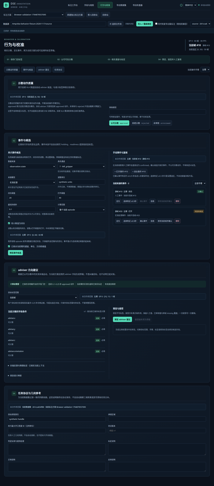

# 行为与校准：范围、前置条件与保存结果

本页包含任务参考、示教动作质量、事件管理、夹爪事件候选和 adviser 自动建议。各项操作使用独立的范围；浏览选区、训练保留区间、动作质量审核和语义标签审核不能互相替代。界面支持简体中文和 English，业务字段名和类别 ID 保持原样。

## 范围一览

| 功能 | 本次作用范围 | 保存结果 |
| --- | --- | --- |
| 任务与几何参考 | 当前方案、当前数据集的参考配置 | 工作项目配置及导出协议附件，不改写原始 task 文本 |
| 示教动作质量 | 当前 episode 的明确选区 `[start,end)` | approved / rejected / unreviewed 与原因 |
| 新建手动事件 | 当前手臂、当前帧 | 一条 confirmed 事件 |
| 事件确认、拒绝、删除、移动 | 所选事件 | 更新/移除该条记录，可撤销 |
| 夹爪事件候选 | 当前 episode 或明确选区 | 先预览，再接受为 suggestion 事件 |
| adviser 当前帧 | 当前手臂、当前帧 | 每个适用分量独立计算的草稿 |
| adviser 当前选区 | 当前手臂、选区内逐帧 | 每帧独立计算，单次事务接受，可一次撤销 |

操作范围均用当前输入 episode 的整数帧和半开区间表达。`[100,131)` 包含 #100–#130。重新导入裁剪导出集后，当前片段帧号与原始源帧号可能不同；事件和候选会通过 source_map 追溯，不应将 provenance 中旧输入帧号直接用于索引新片段。

## 示教动作质量

“示教动作质量”用于**后续 VLA 筛选及自动 adviser 候选**。它回答“这段示教动作适不适合模仿”。审核作用于双臂共享的完整动作向量，不随页顶当前操作手臂变化。标签审核回答“这个语义答案是否已核对”，两者分别保存。

1. 在工作台设置要审核的选区。
2. 对当前选区选择 approved、rejected 或 unreviewed，并填写原因。
3. 没有审核记录的动作不视为 approved。失败画面仍可包含有效的状态语义监督；rejected 不自动取消这些标签。

当前 DSE 标签读取器不根据动作审核自动过滤训练样本，也不生成 BC 动作块 mask。后续 VLA 数据加载器须显式消费审核记录。自动 adviser 会检查这些记录，要求其证据窗口中的动作连续 approved。

## 事件管理

手动 open/closed 按钮在当前帧新建事件。事件是一个变化时刻，不是整段状态标签，也不等于 holding/readiness。

- **定位**：切到行为复核并跳到事件帧。
- **选择附近 ±0.5秒**：设置附近浏览/编辑选区；不自动保留训练中心或审核标签。
- **确认**：将候选标为 confirmed。
- **移到当前帧并确认**：修改原事件的发生帧，不新增事件。
- **拒绝**：保留 rejected 记录，表示候选不成立。
- **删除**：删除该条事件；可用撤销恢复。

confirmed 事件附近约 ±0.25 秒仍进入导出 key 池，这与 ±0.5 秒浏览选区独立。新版 adviser 只用**同一手臂的 confirmed 事件**截断窗口，未确认候选和另一臂事件不再意外截断。删除、拒绝和重复生成会重新检查候选状态；相同来源/手臂/通道/帧/类型的事件不会重复追加，已拒绝事件也不会被重新生成覆盖。

## 夹爪事件候选：先核对曲线，再设规则

这项功能在选定数值通道中寻找稳定的开合变化。具名通道可以是向量的一维，也可以是独立具名标量；界面显示反馈、命令或未明确的来源属性。关节通道不会因为数值过阈值就具有夹爪语义，必须由使用者核对。

- **来源/通道**：例如反馈向量中的 left_gripper 或独立反馈标量。手臂与通道分别核对，不能把左夹爪读数归到右臂。
- **单位**：说明原始数值的单位或尺度，不进行数值换算。
- **闭合/打开阈值**：较小数值为闭合时，读数不高于闭合阈值判为闭合、不低于打开阈值判为打开；闭合阈值须小于打开阈值。方向反过来时，两阈值关系也反转。
- **滞回区**：两个阈值之间暂不触发新切换，未满足的持续计时会重置。
- **最短持续秒**：读数连续满足新状态达到此时长后，才认可变化。事件落在该连续状态的起始帧，而非计时结束帧。
- **已核对配置**：人工确认单位、通道、方向和阈值；勾选本身不会自动标定。

默认值不是针对真实数据测得的标定结果。先找到画面中明确打开和闭合的片段，查看实际通道量程及噪声，再设阈值。命令变化只能产生命令事件，不能证明实际夹爪已经闭合。

选择范围后先预览，再接受候选。选区预览会扫描前面的读数以建立稳定状态，但只返回/保存选定范围内的事件；episode 首个稳定状态仅用于初始化，不产生一次开/闭事件。若没有状态切换或持续时间不足，0 个候选是有效结果。预览后更改数据、手臂、通道、范围或标定会使旧预览失效。

## adviser：从已认可的示教短窗口生成草稿

adviser 描述合格示教采用的实际短窗口运动：x/y/z 为方向，orientation 为是否显著调整姿态。它不推导“应该怎样纠偏”，也不证明当前已对准或具备闭合/释放条件。none/keep 只表示对应分量没有显著运动。

自动建议支持 dse_v1 和 generic。目标可以是 `adviser.x/y/z`、`adviser.orientation` 或 `adviser.rot_x/rot_y/rot_z` 中已发布的 categorical、each_arm、behavior 字段。是否适用由各字段的门控决定。

使用顺序：

1. 保存当前方案的门控标签；未提交的表单草稿和规则草稿不参与计算。
2. 用“示教动作质量”把可信短动作范围审核为 approved。
3. 核对当前臂的实测末端字段、米制单位、robot_base 变换和噪声。原始位姿布局为 `[x,y,z,qx,qy,qz,qw]`；不能用命令位姿、另一臂位姿或填零代替。
4. 核对类别映射。标准 key 可自动匹配 none/positive/negative 或 keep/adjust，unknown 取该字段的 unknown_id。自定义 key 要显式映射；类别 ID 可不连续，各字段也可不同。
5. 选择当前帧或当前选区并预览，检查每个分量的可用性、窗口、截断原因和保存数量。
6. 接受缺失项为草稿，再在行为复核中人工审核。

适用与必填分别计算：适用为 true 才能继续生成；适用未知不会被强行改为 false 或 unknown 标签。适用但非必填的字段可以建议。计算从 t 开始取连续 approved 前缀，最长 0.25 秒、至少 0.1 秒；遇门控或依赖值变化、同臂 confirmed 事件、数据断裂或动作审核中断即停止。转移 i→i+1 要求源帧 i 的动作 approved，不跨过 rejected/unreviewed 去拼接后续恢复动作。

单次 adviser 目标选区最多 5,000 帧；更长范围应分段预览。选区内每帧使用自己的短窗口，允许读取选区外最多 0.25 秒的合格未来，但只写选区内目标帧。行为页面较长的未来显示跨度不改变计算窗口。平移死区为 max(5 mm, 3×位置噪声)，姿态阈值为 max(5°, 3×角噪声)；明显往返/抵消输出该分量的 unknown，不能以很小的净变化当作 none/keep。无效四元数不会生成 keep；位置有效时平移分量仍可独立计算。

### 旋转方向和角度

`adviser.orientation` 的预览显示净转角、累计转角和机器人基座系的净旋转向量。旋转向量是首尾相对姿态的最短转轴乘转角，预览以度显示三个分量。每个分量的正负遵循对应基座轴的右手定则。例如 `Z +12°` 表示净旋转在基座 +Z 轴上的分量为 12°。

在「字段与规则」点击「添加 adviser 旋转方向字段」，可将 `adviser.rot_x`、`adviser.rot_y`、`adviser.rot_z` 加入草稿。这三个字段默认选填，并沿用当前按臂 `adviser.orientation` 的适用条件。如无相应字段，默认适用。发布后可在「行为与校准」生成 `none`、`positive`、`negative` 或 `unknown` 候选。每轴分量独立使用姿态阈值。若逐帧投影明显往返，或它的累计净值与首尾净分量差异超过阈值，该轴为 `unknown`。相对旋转接近半圈时，方向为 `unknown`。

接受只填真正缺失项，保留人工值、unknown、已审核/需复核值和显式单帧 missing。结果为 `label_source=rule_suggestion`、`review_status=draft`，人工审核前 mask=0；一次接受可一次撤销。方案、范围、标注修订、审核、事件或标定改变后，需要重新预览。

## 数据保存与导出

事件来源记录在工作库 events.details；导出后在 `annotations/intervals.parquet` 的 table=events 行中，先解析 payload，再解析 details。单位位于 `details.calibration.unit`，不是独立 Parquet 列。手动事件通常只有 human 来源说明。

adviser 接受记录在标签 provenance，导出到 `annotations/labels.parquet` 和 `intervals.parquet` 的 annotation 记录。新版记录规则版本、输入数据/帧、稳定源 UUID/源帧、实际证据窗口、门控依赖、类别映射、标定、approved 依据和截断原因。旋转候选还保存 `provenance.rotation`，其中包括基座系、净角度、累计角度和可用的净旋转向量。旧候选可能使用旧的扁平窗口/coordinate_config 结构，应按实际 rule_version 解释。

任务参考和辅助标定配置随 `annotations/behavior_protocol.json` 冻结导出；manifest.behavior_protocol 记录文件路径和 SHA-256。原始 tasks.jsonl 文本保持原样。附件只包含当前数据集的任务配置和分臂辅助 profiles；旧版未分数据集的备注另存为 legacy_task_notes。显式恢复导出标注时恢复该协议，并清除事件/位姿标定的 verified 和旧 binding，需重新核实；仅加载来源不恢复配置。协议保留使用者声明，不能证明单位、几何标定或语义标签正确。

## 界面与验证

2026-11-17：139 项 Python 回归、生产构建、四组前端检查及隔离浏览器验收通过。浏览器验证涵盖 192 项草稿的原子接受/撤销、事件删除/撤销和去重、协议导出、中英切换，以及 1440/960/390 像素布局。使用临时合成数据，未操作真实标注工作库。机器记录见 [behavior-calibration-validation.json](behavior-calibration-validation.json)。
