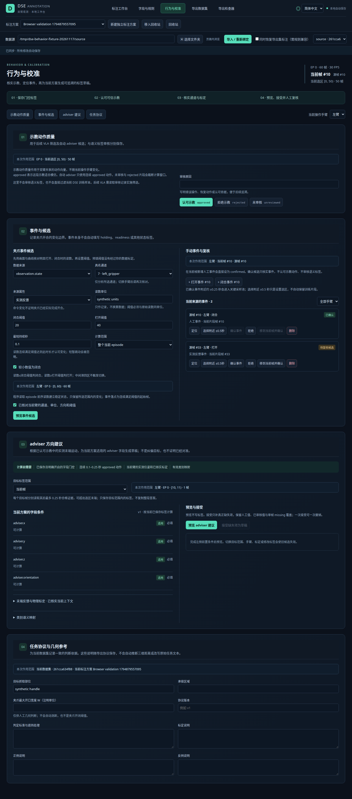

# Behavior and calibration: scope, prerequisites, and saved results

This page contains task references, demonstration-action quality, event management, gripper-event candidates, and adviser suggestions. Each operation has its own scope. A browsing selection, training-center selection, action review, and semantic-label review are independent. Chinese and English UI labels change together; business field names and stable class IDs remain unchanged.

## Scope at a glance

| Feature | Operation scope | Saved result |
| --- | --- | --- |
| Task and geometry reference | Reference configuration of the current scheme and dataset | Project settings and an exported protocol attachment; original task text is preserved |
| Demonstration-action quality | Explicit selection `[start,end)` in the current episode | approved / rejected / unreviewed and a reason |
| New manual event | Current arm and frame | One confirmed event |
| Confirm, reject, delete, or move event | Selected event | Update/remove that record, with undo |
| Gripper-event candidates | Current episode or explicit selection | Preview first, then accept suggestion events |
| Adviser: current frame | Current arm and frame | Independent drafts for applicable components |
| Adviser: current selection | Each frame in the selection, current arm | Per-frame calculations accepted in one undoable transaction |

Operation ranges use integer frames of the current input episode and exclusive ends: `[100,131)` includes frames 100–130. In a re-imported cropped dataset, local frame numbers may differ from original source frames. source_map preserves event/candidate provenance; old input-frame numbers inside provenance are not current-video indices.

## Demonstration-action quality

This review is **for later VLA filtering and automatic adviser candidates**. It asks whether demonstrated actions are suitable imitation targets. It applies to the full action vector shared by both arms, regardless of the active-arm selector. Semantic-label review asks whether an annotation has been checked. The records are separate.

1. Set an explicit selection in the workbench.
2. Mark that selection approved, rejected, or unreviewed, and enter a reason.
3. Missing action-review records are not approved. Failure images may still contain valid state supervision; rejected actions do not automatically invalidate those labels.

The current DSE label reader does not filter training samples by action-quality status and does not generate a BC action-chunk mask. A later VLA loader must explicitly consume these records. Automatic adviser generation requires a continuous approved action prefix.

## Event management

Manual open/closed buttons create an event at the current frame. An event is a transition time, not a state label for the remaining episode, and does not establish holding or readiness.

- **Locate** switches to behavior review at the event frame.
- **Select nearby ±0.5 s** prepares a browsing/editing selection; it does not retain training centers or review labels.
- **Confirm** changes a candidate to confirmed.
- **Move to current frame and confirm** moves the existing event, without adding a second one.
- **Reject** retains a rejected record indicating an invalid candidate.
- **Delete** removes the event; undo restores it.

Confirmed events still place roughly ±0.25 s neighborhoods in the exported key pool, independently of the ±0.5 s browsing selection. The new adviser window uses **confirmed events for the same arm**; suggestions and other-arm events no longer unexpectedly cut it short. Candidate acceptance deduplicates by source/arm/channel/frame/type, including previously rejected events, rather than resurrecting or duplicating them.

## Gripper-event candidates: inspect the signal before setting thresholds

This detector finds stable open/closed transitions in a selected numeric channel. A named channel can be a vector dimension or a separate named scalar. Sources are identified as feedback, command, or unspecified. A joint channel does not acquire gripper meaning merely by crossing a threshold; the user must verify its semantics.

- **Source/channel:** for example left_gripper within the feedback vector or a separate feedback scalar. Verify the arm and channel separately.
- **Unit:** describes the original numeric scale; it does not convert values.
- **Closed/open thresholds:** with smaller-is-closed, values at/below the closed threshold indicate closed and values at/above the open threshold indicate open. The closed threshold must be lower. Reverse both the direction and ordering when larger values mean closed.
- **Hysteresis interval:** values between thresholds do not trigger a new transition and reset an unfinished duration check.
- **Minimum duration:** the new threshold state must persist for this many seconds. The event is placed at the beginning of that continuous interval, rather than when its duration is confirmed.
- **Verified configuration:** a user confirmation of the channel, unit, direction, and thresholds; checking it does not perform calibration.

Defaults are not measurements of your robot. Find clearly open and closed video segments, inspect the channel's scale and noise, and set thresholds from that evidence. A command transition does not establish actual physical closure.

Preview the chosen scope, then accept candidates. A selection preview scans preceding rows to initialize the stable state, but returns/saves only events inside the requested range. The first stable state of an episode initializes the detector and is not itself an event. Zero candidates is valid when no transition meets the thresholds/duration. Changes to data, arm, channel, scope, or calibration invalidate the preview.

## Adviser: drafts from an approved short demonstration window

Adviser describes observed short-window movement in a qualified demonstration: x/y/z directions and significant orientation adjustment. It does not derive a target-error correction, establish alignment, or authorize closing/releasing. none/keep means only no significant motion in that component.

Both dse_v1 and generic schemes are supported. Target fields must actually exist among `adviser.x/y/z/orientation` and be categorical, each_arm, and behavior evidence. No fixed phase IDs are imposed on generic schemes. Missing, gated-off, or undetermined fields have explicit reasons, and only a subset of components may be enabled.

Workflow:

1. Save the scheme's gate labels. Unsaved annotation drafts and unpublished schema drafts do not participate.
2. Use Demonstration-action quality to approve a trustworthy action range.
3. Verify the selected arm's measured pose feature, metric units, robot_base transform, and noise. The raw pose layout is `[x,y,z,qx,qy,qz,qw]`; commands, the other arm, or fabricated zeros cannot substitute for feedback.
4. Check class mappings. Standard keys match none/positive/negative or keep/adjust; unknown uses each field's unknown_id. Custom keys need explicit mappings. Stable IDs may be sparse and different for every field.
5. Preview the current frame or selection and inspect component availability, actual windows, cutoff reasons, and save counts.
6. Accept missing entries as drafts, then inspect and review them in behavior mode.

Applicability and requiredness are separate. Only true applicability permits calculation. An undetermined gate is not forced to false or replaced by an unknown answer. Applicable optional fields can receive suggestions. Starting at t, computation uses a continuous approved prefix of 0.1–0.25 s and stops on changed gate/dependency values, a confirmed same-arm event, data discontinuity, or interrupted action approval. Pose transition i→i+1 requires the action at source frame i to be approved; rejected/unreviewed gaps cannot be skipped to reach a later recovery.

One adviser target selection is limited to 5,000 frames; preview longer ranges in sections. Every selected frame uses its own window. Qualified future evidence may extend up to 0.25 s beyond the target selection, while saved labels remain inside the selection. Longer future-image display horizons do not change this limit. Translation uses max(5 mm, 3×position noise), and orientation uses max(5°, 3×angular noise). Significant reversal/cancellation maps the affected component to unknown, rather than treating a small net change as none/keep. Invalid quaternions cannot produce keep; valid positions can still support translation independently.

Acceptance fills only truly absent entries and preserves human values, unknowns, reviewed/needs-review records, and explicit single-frame missing overrides. New records have `label_source=rule_suggestion`, `review_status=draft`, and mask=0 before human review. One undo restores an accepted batch. Changes to the scheme, target range, revisions, action review, events, or calibration require a fresh preview.

## Storage and export

Event origin/configuration is stored in events.details in the work database. In `annotations/intervals.parquet`, filter table=events, parse payload, then parse details. Units are in `details.calibration.unit`, not a separate Parquet column. Manual events usually contain only a human-origin marker.

Accepted adviser records carry provenance in `annotations/labels.parquet` and annotation rows in `intervals.parquet`. New provenance includes the rule version, input dataset/frame, stable source UUID/frame, actual evidence window, gate dependencies, class mapping, calibration, approved basis, and cutoff reason. Older candidates may use flat window/coordinate_config fields; interpret the actual rule_version.

Task references and auxiliary calibration settings are frozen into `annotations/behavior_protocol.json`; manifest.behavior_protocol records its path and SHA-256. Original tasks.jsonl text is preserved. The attachment contains only the current dataset's task settings and per-arm auxiliary profiles; unscoped legacy notes are retained separately as legacy_task_notes. The protocol is restored only when explicitly restoring exported annotations, not when loading sources alone. Restored event/pose calibration clears verified and the old binding and needs fresh verification. It records user declarations and does not certify physical calibration or semantic-label correctness.

## Interface and validation

2026-11-17: 139 Python tests, production build, four frontend checks and isolated browser acceptance passed. Browser checks covered atomic application/undo of 192 drafts, event deletion/undo and deduplication, protocol export, language switching, and 1440/960/390px layouts. Only temporary synthetic data was used. See [machine-readable validation](behavior-calibration-validation.json).
