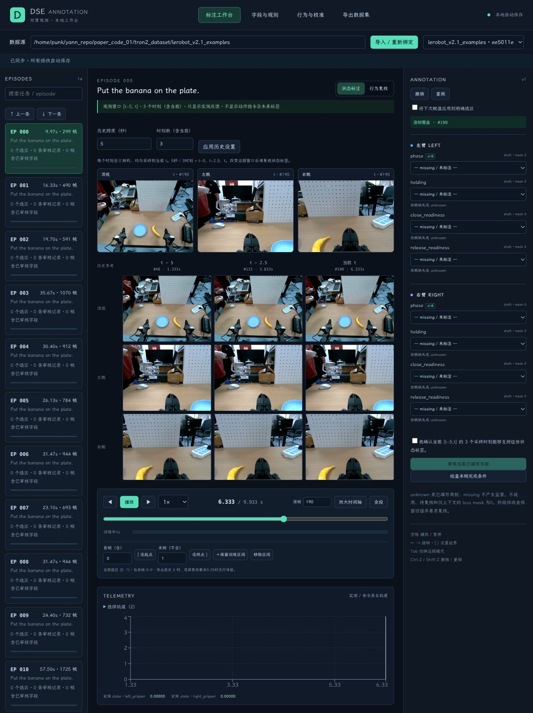
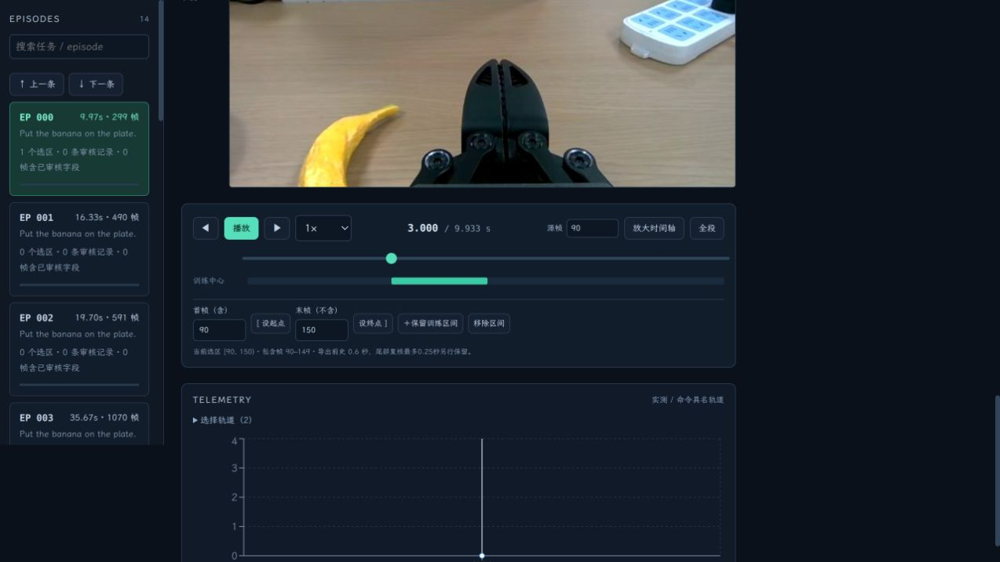

# 可配置历史：标注、导出与训练加载

2026-10-31。默认 0.6 秒 / 4 时刻保持兼容，新增可变跨度 H 与总时刻数 T。T 包含当前帧，每时刻含三相机。5 秒 / 3 时刻表示 t−5、t−2.5、t；若想三个过去时刻再加当前，设 T=4。H=0、T=1 支持只看当前的消融。

主页修改历史设置并应用，图像、状态证据窗口、审核确认文字自动更新，配置可刷新恢复。新状态审核的 provenance 保存当时 H/T。改变设置不会自动变更原有标签的审核结论；较短或较稀疏历史实验须核对状态真值是否仍可由输入判断，必要时重新审核。

导出页的“保留前史”可大于默认采样跨度，例如一次保留 5 秒连续数据、默认仍用 0.6 秒 / 4 时刻。manifest 中 `history_sampling` 保存采样配置，`context_seconds.history` 保存保留容量。目录搬移、重开后继承采样配置。旧导出只有 0.6 秒时，界面、再导出和训练 loader 都拒绝凭空请求 5 秒，需回原始数据重新导出。

```python
from dse_tool.adapter import DSEDataset, to_torch_batch
from dse_tool.history import HistoryConfig

reader = DSEDataset(
    '/path/to/export-with-5s-context',
    cache='/path/to/work/train-cache',
    history_config=HistoryConfig(horizon_seconds=5.0, num_frames=3),
    # 同样接受 {'horizon_seconds': 5.0, 'num_frames': 3}
)
batch = reader.batch([0, 1])
# images: [2,3,3,3,256,256]，RGB float32 [0,1]
# state: [2,3,18]，ee_pose_feedback: [2,3,2,7]
# image_valid_mask: [2,3,3]，state_valid_mask: [2,3]
# ee_pose_valid_mask: [2,3,2]
# history_target_offsets / history_actual_offsets: [2,3]，单位秒
# history_frame_indices: [2,3]，当前导出 episode 内的行号
experiment_history = reader.history_config.to_dict()
# 若安装了 PyTorch，可用 to_torch_batch(batch)。
```

省略 history_config 时读取 manifest；旧 manifest 未记录时采用 0.6 秒 / 4 时刻。同一个 reader 的所有样本使用同一 T，可直接堆叠；不同实验分别建立 reader。`history_target_offsets` 为 [-H,…,0]；实际时间取目标之前最近行，`history_actual_offsets` 可更早。真实 episode 开头不足历史时图像/遥测置零，存在性 mask 为 false，行号 -1、实际时间 NaN；时间编码前须按 mask 清零。禁止把 NaN 输入网络，也不要把缺失历史复制成当前帧。

可配置采样由 `backend/dse_tool/history.py` 统一实现，Dataset、窗口 API、训练 wrapper 共用；导出保留目标前的 floor 行以支持非整帧时间偏移。图像、本体、末端反馈都读取相同源行；独立 episode 间不取历史。动作、命令和未来图像不进入训练 batch。标签 loss mask、类别 ID、同源 split_group 和 adviser 的 0.25 秒未来监督窗口保持原有含义。

DSE 网络与完整训练循环尚未实现；后续网络必须按 T 生成时序 token / attention mask，使用实际相对秒数编码，并将 H/T 与 checkpoint 一起保存。36D 本体转换已支持任意 T。

## 验证

- `./scripts/test.sh -q`：29 项通过，包含可变 T/跨度、当前帧消融、因果采样、padding、API 参数校验、审核 provenance、配置持久化、导出容量、搬移重开、旧版本兼容及训练张量。
- 前端 TypeScript/Vite 构建通过，Python/前端格式检查及 diff 检查通过。
- 浏览器实测真实 AV1 三相机：5 秒 / 3 时刻，帧190对应40/115/190；刷新恢复、单时刻模式、导出重开继承均通过。
- `scripts/validate_history.py`：真实数据选中心 [190,193)，保留源帧 [40,200)，独立导出后搬移；5秒三时刻得到 [2,3,3,3,256,256] 图像与 [2,3,18] state，再用同一导出加载0.6秒四时刻成功。未创建任何真实语义标签。前后原始数据哈希相同，见 [机器报告](history-validation.json)。
- 重跑真实验收时设置新的 `DSE_HISTORY_RUN`，避免覆盖既有验收目录。



## 时间轴游标对齐修复

点击训练中心区间时，游标定位到区间首帧。此前游标横跨整行，区间条却为左侧文字预留空间，且缩放时区间条仍按整段比例绘制，造成游标看起来提前的偏移。

现在游标、训练中心、阶段、事件及字段轨使用相同的轴起点和缩放范围；统一处理原生滑块圆点的宽度与帧索引范围。点击训练区间暂停播放；手动跳出当前缩放范围时恢复全段，避免滑块显示位置与实际帧号不一致。

浏览器在真实 AV1 数据上验证：点击 [90,150) 后，0秒/1时刻、0.6秒/4时刻、5秒/3时刻都定位90，圆点中心与区间起点误差约0.0016像素；放大至[60,120]后误差0像素。首帧0、末帧298均与轴端点对齐。前端 TypeScript/Vite 构建通过；结果见 [时间轴验收记录](timeline-alignment-validation.json)。本次只在独立 QA 工作库新增选区，没有修改原数据和现有标注工作库。


