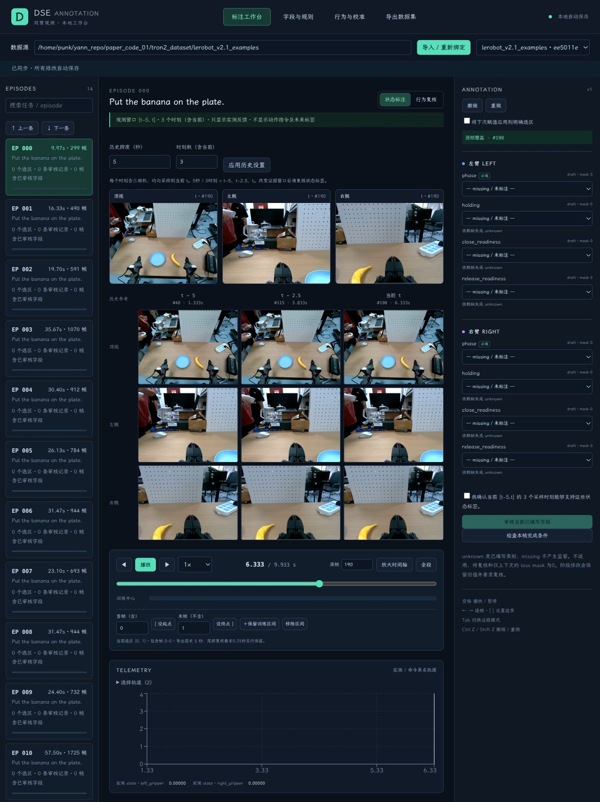
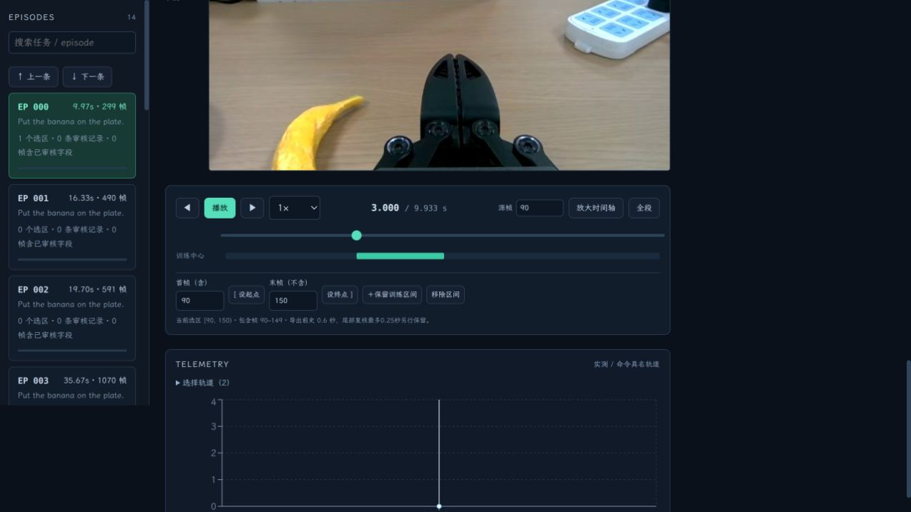

# Configurable History: Annotation, Export, and Training Loading

English | [简体中文](CONFIGURABLE_HISTORY_2026-10-31.md)

2026-10-31. The default 0.6 seconds / 4 timestamps remains compatible, with configurable history span H and total timestamp count T. T includes the current frame, and every timestamp contains all three cameras. 5 seconds / 3 timestamps means t−5, t−2.5, t. For three past timestamps plus the current one, set T=4. H=0, T=1 supports current-frame-only ablation.

Change and apply history settings on the home page. Images, the state-evidence window, and review-confirmation text update automatically; settings survive refresh. Provenance for new state reviews records H/T. Changing settings does not automatically change existing labels' review decisions. For shorter or sparser history, verify that state ground truth remains observable from the input and review again when needed.

The export page's **保留前史** (Retain history) can exceed the default sampling horizon: for example, retain 5 seconds of continuous data while keeping 0.6 seconds / 4 timestamps as the default. In the manifest, `history_sampling` stores the sampling configuration and `context_seconds.history` stores retained capacity. Moving and reopening the directory preserves the configuration. When an older export retains only 0.6 seconds, the UI, re-export, and training loader all reject a request for 5 seconds; re-export from the original data.

```python
from dse_tool.adapter import DSEDataset, to_torch_batch
from dse_tool.history import HistoryConfig

reader = DSEDataset(
    '/path/to/export-with-5s-context',
    cache='/path/to/work/train-cache',
    history_config=HistoryConfig(horizon_seconds=5.0, num_frames=3),
    # Also accepts {'horizon_seconds': 5.0, 'num_frames': 3}
)
batch = reader.batch([0, 1])
# images: [2,3,3,3,256,256], RGB float32 [0,1]
# state: [2,3,18], ee_pose_feedback: [2,3,2,7]
# image_valid_mask: [2,3,3], state_valid_mask: [2,3]
# ee_pose_valid_mask: [2,3,2]
# history_target_offsets / history_actual_offsets: [2,3], in seconds
# history_frame_indices: [2,3], row indices within the current exported episode
experiment_history = reader.history_config.to_dict()
# With PyTorch installed, use to_torch_batch(batch).
```

Omitting history_config uses the manifest, or 0.6 seconds / 4 timestamps if an older manifest has no configuration. All samples from one reader share T and can be stacked directly; create separate readers for separate experiments. `history_target_offsets` is [-H,…,0]. Actual timestamps use the nearest row at or before each target, so `history_actual_offsets` may be earlier. At a real episode's beginning, unavailable history images/telemetry are zero, existence masks are false, row indices are -1, and actual timestamps are NaN. Zero the timestamps using the mask before time encoding. Never feed NaN into the network or duplicate the current frame as missing history.

`backend/dse_tool/history.py` implements the shared sampling used by Dataset, the window API, and the training wrapper. Export also retains the floor row before a target to support nonintegral frame offsets. Images, proprioceptive state, and end-effector feedback use the same source row; history never crosses episode boundaries. Actions, commands, and future images do not enter training batches. Label loss masks, category IDs, same-source split_group, and the adviser's 0.25-second future-supervision window retain their previous meanings.

The DSE network and complete training loop are not implemented. Later networks must build temporal tokens / attention masks according to T, encode actual relative seconds, and save H/T with checkpoints. 36D proprioception conversion already supports arbitrary T.

2026-11-01 supplement: each export has one default H/T configuration, and a reader override applies uniformly to all its centers. Mixed-H/T training needs explicit later implementation; the current batch interface does not configure individual samples. Training code chooses forward inputs for image-only or other modality experiments; the reader still returns complete observations. 36D conversion accepts valid measured quaternions only, so filter padding first. Models must apply existence masks, and losses must apply label masks. Images currently provide only RGB `[0,1]`; checkpoint preprocessing and full 36D training statistics still need integration. The reader does not automatically judge whether reviews remain compatible with shorter/sparser history or fewer modalities.

## Validation

- `./scripts/test.sh -q`: 29 tests passed at the time of this report, covering variable T/span, current-only ablation, causal sampling, padding, API validation, review provenance, persistence, export capacity, moving/reopening, older-version compatibility, and training tensors.
- Frontend TypeScript/Vite build, Python/frontend formatting checks, and diff checks passed.
- Browser checks on real three-camera AV1 data: with 5 seconds / 3 timestamps, frame 190 uses 40/115/190. Refresh persistence, single-timestamp mode, and reopening an export with inherited configuration passed.
- `scripts/validate_history.py`: real-data centers [190,193), retained source range [40,200), standalone export followed by moving it. Five-second, three-timestamp loading produced images [2,3,3,3,256,256] and state [2,3,18]; the same export also loaded successfully with 0.6 seconds / 4 timestamps. No real semantic labels were created. Original-data hashes matched before/after; see the [machine report](history-validation.json).
- Set a new `DSE_HISTORY_RUN` when repeating real-data acceptance to preserve existing result directories.



## Timeline Cursor Alignment Fix

Clicking a training-center range moves the cursor to its first frame. Previously, the cursor spanned the whole row while range bars reserved space for labels on the left. Range bars also continued using full-episode proportions when zoomed, making the cursor appear early.

The cursor, training centers, phase, events, and field tracks now share the same axis origin and zoom range, with consistent handling of the native slider thumb width and frame-index bounds. Clicking a training range pauses playback. Manually jumping outside the zoom range restores the full episode to keep the slider aligned with the actual frame number.

Browser checks on real AV1 data: clicking [90,150) moved to frame 90 with 0 seconds / 1 timestamp, 0.6 seconds / 4 timestamps, and 5 seconds / 3 timestamps. The slider-thumb center differed from the range start by about 0.0016 pixels; after zooming to [60,120], the difference was 0 pixels. First frame 0 and last frame 298 aligned with the axis endpoints. Frontend TypeScript/Vite build passed; see the [timeline acceptance record](timeline-alignment-validation.json). Only selections in an isolated QA work database were added; original data and existing annotation work databases were unchanged.


