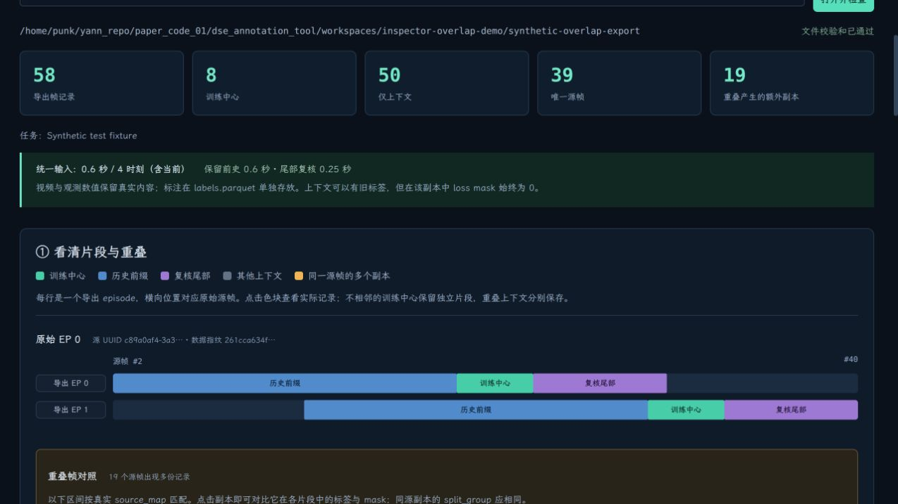
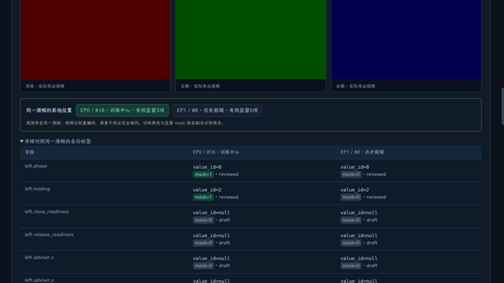
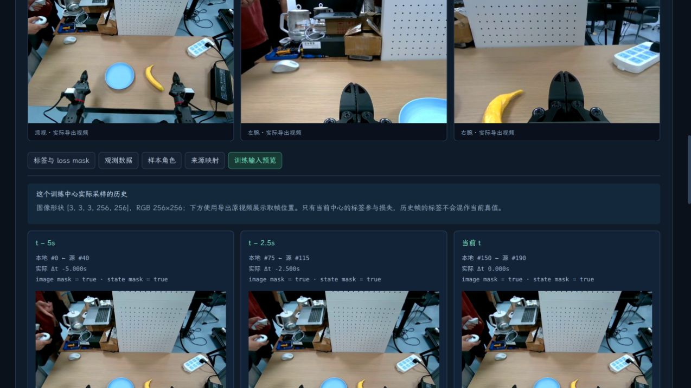

# 导出数据集检查器

工具已集成在工作台顶部的「导出检查器」中。它直接读取已导出的目录，不需要先将该目录导入标注项目。当前标注草稿、schema 版本和训练选区不会被检查操作改动；视频索引与 JPEG 缓存写在工作目录，数据集本身只读。

## 打开自己的数据

1. 重启原服务，保留原来的 `--work`，然后刷新页面。
2. 点击「导出检查器」，填写已导出的数据集目录，点击「打开并检查」。也可在导出作业完成后点「可视化检查此导出」。
3. 第一部分查看片段地图，第二部分逐帧检查，第三部分查看文件和原始内容。

检查器打开时校验 manifest 中的文件校验和；校验失败会说明原因。打开后检测到文件变化会要求重新打开，避免将旧索引和新文件混用。该工具展示的是磁盘上的导出快照，不会把当前未导出的标注编辑混入结果。

## 怎么回答你的两个问题

**历史前缀没有标注时，Parquet 到底保存了什么？**

在地图上点击蓝色「历史前缀」，然后依次切换：

- 「观测数据」：查看 `data/...parquet` 的实际数值。state、action 和末端反馈仍是观测/示教内容，不会因为没有标签被清零。视频在独立 MP4 中，帧号和时间戳将两者关联。
- 「标签与 loss mask」：逐字段查看 `labels.parquet` 的原始 `value_id`、missing/labeled、适用性、审核状态和 mask。没有值就是 null，loader target 显示 −100，不伪造为0或unknown。有已保存标签的上下文可保留该值，mask 仍为0。
- 「样本角色」：查看 `samples.parquet` 中的全部布尔标记、采样权重、split_group。`center_is_selected=false` 的上下文不单独产出训练样本。
- 「来源映射」：查看 `source_map.parquet` 的原始 UUID、源帧、源时间和直接父集。

**两个区间的历史有重叠，怎么处理？**

同一源 UUID 的导出片段画在同一条源帧坐标轴上，因此蓝色、绿色和紫色区间重叠的位置可以直接看见。下方列出准确的重叠源帧区间及它在每个导出 episode 中的位置，点击即可跳转。

当前导出规则：相邻/重叠的训练中心合并；不相邻的中心保留独立 episode。上下文重叠时各片段分别保存，不把间隔拼接成连续训练中心。通过源 UUID+源帧号关联，并保留相同 split_group。视频各自重编码，不能承诺两份副本像素完全一样。

同一源帧可能在 A 中是训练中心，在 B 中是历史前缀。详情中的「同一源帧的其他位置」可切换副本；展开「并排对照同一源帧的各份标签」可直接对比 value_id、审核状态和 mask。

## 一个可以亲自点开的例子（合成测试）

本机准备了一份**合成测试数据**，不是实际机器人标签：

```text
/home/punk/yann_repo/paper_code_01/dse_annotation_tool/workspaces/inspector-overlap-demo/synthetic-overlap-export
```

它从同一段合成视频中选择源帧 `[20,24)`、`[30,34)`，使用0.6秒历史、4时刻，导出两个片段。共58条导出帧记录、8个中心、39个唯一源帧，重叠产生19条额外副本。

| 记录位置 | 原始源帧 | 角色 | left.phase 实际值 | 审核状态 | loss mask |
|---|---:|---|---|---|---:|
| 导出EP0 / 本地帧18 | 20 | 训练中心 | 8（unknown） | reviewed | 1 |
| 导出EP1 / 本地帧8 | 20 | 历史前缀 | 8（unknown） | reviewed | 0 |
| 导出EP1 / 本地帧0 | 12 | 历史前缀 | null | draft | 0 |

最后一行的观测 state 仍为 `[12,13,…,29]`，不是零。它的缺失标签经过 wrapper 转为 target=−100。这与 episode 开头根本不存在某个历史时刻的 padding 不同：padding 是加载时生成，不是把一条已存在的历史观测改成零。





## 训练输入预览

选择绿色训练中心，切换「训练输入预览」。界面显示该中心实际取到的每个历史时刻、实际相对时间、三相机画面和存在性 mask；可继续点开某个历史帧核对保存记录。

真正不足的历史时刻显示 padding 卡；不存在的图像/遥测置零，mask=false。仅上下文的帧会明确提示「不单独产出训练样本」，并提供返回训练中心的按钮。预览不改变采样配置，也不执行模型训练。RGB取帧位置来自导出视频；默认 wrapper 图像形状为 `[T,3,3,256,256]`，分类 target 和 loss_masks 由实际保存行读取。

真实导出测试在源帧190准确显示40/115/190三个时刻，时间差−5/−2.5/0秒：



## 原始文件内容

第三部分列出实际目录中的文件、字节数和 Parquet 行数。展开 Parquet 文件可看 Arrow 列类型和 nullable；点击「预览实际文件内容」可按20行分页查看。JSON/JSONL 文件也可打开，包含 schema、head_spec、intervals、统计、源映射等，不只是展示一个目录示意图。原始值与辅助解释分开显示。

## 验证

- 33项回归测试通过；新增检查包含重叠角色、null、unknown、上下文mask0、原始观测、源映射、分页、文件变更检测、视频解码、移目录重开及不改标注DB/导出文件。
- 预览中的分类 target、loss_masks 与 DSEDataset 的实际输出对照一致；episode开头的历史缺失mask也有回归测试。
- 前端 TypeScript/Vite 构建通过。浏览器分别查看了合成重叠样例和真实独立导出，验证切换副本、观测值、训练抽帧、视频放大与文件预览。
- 真实导出内容哈希前后相同。详见 [机器验收记录](export-inspector-validation.json)。本次未创建真实人工语义标签。

首次打开会读取标签/映射并校验媒体，界面逐帧列表和文件内容按页显示；目前未对超大型数据集的内存与耗时作规模验收。
