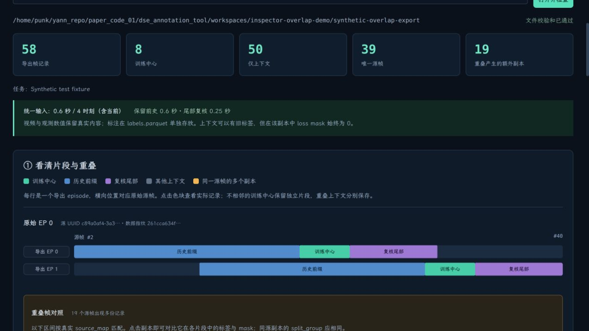
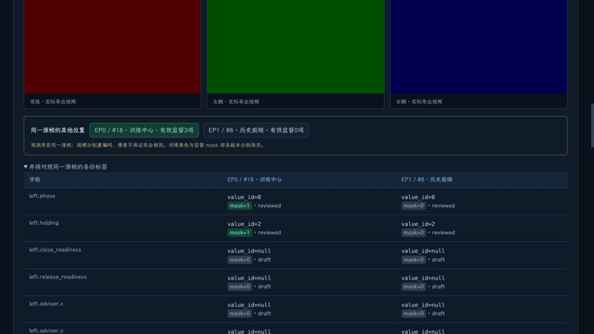
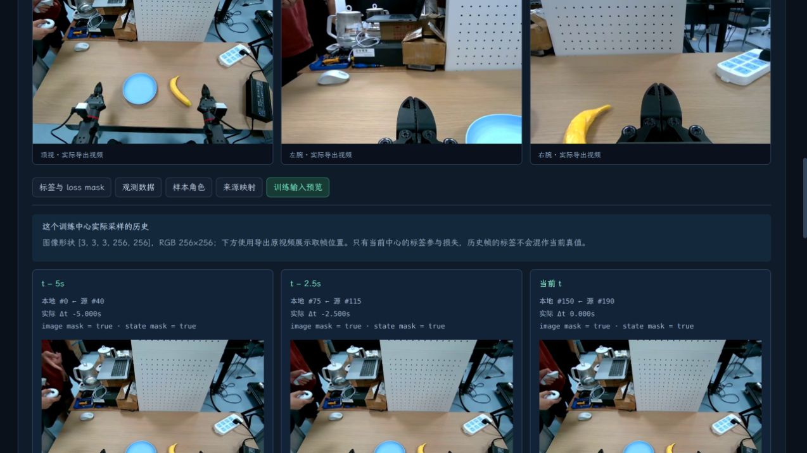

# Exported Dataset Inspector

English | [简体中文](EXPORT_INSPECTOR_2026-10-31.md)

The inspector is integrated into **导出检查器** (Export inspector) at the top of the workbench. It reads exported directories directly without first importing them into the annotation project. Inspection does not change current drafts, schema versions, or training selections. Video indices and JPEG caches go into the work directory; the dataset itself is read-only.

## Open Your Data

1. Restart the existing service with the same `--work`, then refresh the page.
2. Open **导出检查器**, enter an exported dataset directory, and click **打开并检查** (Open and inspect). After an export finishes, **可视化检查此导出** (Visually inspect this export) also opens it.
3. The first section shows the segment map, the second supports per-frame inspection, and the third displays files and raw contents.

Opening verifies file checksums in the manifest and explains failures. File changes detected afterward require reopening, preventing old indices from being mixed with new files. The inspector displays the exported snapshot on disk without incorporating current edits that have not been exported.

## Two Questions the Inspector Answers

**What does Parquet store when the history prefix has no labels?**

Click the blue **历史前缀** (History prefix) on the map and switch between:

- **观测数据** (Observations): actual values in `data/...parquet`. State, action, and measured end-effector feedback remain observation/demonstration data; missing labels do not zero them. Video lives in separate MP4 files linked by frame number and timestamp.
- **标签与 loss mask** (Labels and loss masks): actual `value_id`, missing/labeled status, applicability, review status, and mask from `labels.parquet`, field by field. Missing values are null, and the loader target is −100; they are not fabricated as 0 or unknown. Context with a saved label may retain the value while keeping mask=0.
- **样本角色** (Sample roles): all boolean flags, sampling weights, and split_group in `samples.parquet`. Context with `center_is_selected=false` does not independently produce a training sample.
- **来源映射** (Source mapping): original UUID, frame, timestamp, and direct parent in `source_map.parquet`.

**How is overlapping history from two ranges handled?**

Segments sharing a source UUID appear on the same source-frame axis, so overlap between blue, green, and purple ranges is visible directly. The list below gives exact overlapping source-frame ranges and their positions in each exported episode; click to jump.

Current export rules merge adjacent/overlapping training centers and retain nonadjacent centers as independent episodes. Overlapping context is saved separately in each segment rather than joining gaps into continuous training centers. Copies are associated through source UUID+frame and share split_group. Videos are re-encoded separately, so copies are not guaranteed to be pixel-identical.

The same source frame may be a center in A and a history prefix in B. **同一源帧的其他位置** (Other locations of this source frame) switches copies; **并排对照同一源帧的各份标签** (Compare labels for copies of this source frame side by side) compares value_id, review status, and mask directly.

## A Clickable Example: Synthetic Test Data

A **synthetic test dataset** is available locally; it does not contain real robot labels:

```text
/home/punk/yann_repo/paper_code_01/dse_annotation_tool/workspaces/inspector-overlap-demo/synthetic-overlap-export
```

It selects source centers `[20,24)` and `[30,34)` from one synthetic video, with 0.6 seconds of history and 4 timestamps, producing two segments. There are 58 exported frame records, 8 centers, and 39 unique source frames; overlap adds 19 copies.

| Record | Source frame | Role | Actual left.phase | Review status | Loss mask |
|---|---:|---|---|---|---:|
| Export EP0 / local frame 18 | 20 | Training center | 8 (unknown) | reviewed | 1 |
| Export EP1 / local frame 8 | 20 | History prefix | 8 (unknown) | reviewed | 0 |
| Export EP1 / local frame 0 | 12 | History prefix | null | draft | 0 |

The last row still contains observation state `[12,13,…,29]`, not zeros. Its missing label becomes target=−100 in the wrapper. This differs from padding when an episode has no frame at a requested historical time: padding is generated during loading, rather than zeroing an existing historical observation.





## Training Input Preview

Select a green training center and open **训练输入预览** (Training input preview). It shows each actually sampled historical timestamp, actual relative time, all three camera images, and existence masks. Open a historical frame to inspect its stored records.

Unavailable history shows padding cards: missing images/telemetry are zero with mask=false. Context-only frames explicitly state that they do not independently produce training samples and provide a return-to-center button. Preview does not change sampling settings or train a model. RGB frame positions come from the exported video. The default wrapper image shape is `[T,3,3,256,256]`; classification targets and loss_masks are read from actual saved rows.

For a real export, source frame 190 correctly shows frames 40/115/190 at relative times −5/−2.5/0 seconds:



## Raw File Contents

The third section lists actual files, byte sizes, and Parquet row counts. Expand a Parquet file to see Arrow column types and nullability. **预览实际文件内容** (Preview actual file contents) pages through 20 rows at a time. JSON/JSONL can also be opened. The file browser covers schema, head_spec, intervals, statistics, source mapping, and more, rather than only showing a directory diagram. Raw values are displayed separately from explanatory information.

## Validation

- 33 regression tests passed at the time of this report. Added checks cover overlapping roles, null, unknown, context mask=0, raw observations, source mapping, pagination, file-change detection, video decoding, moving/reopening, and unchanged annotation databases/exported files.
- Preview classification targets and loss_masks match actual DSEDataset outputs. Missing-history masks at episode starts also have regression coverage.
- Frontend TypeScript/Vite build passed. Browser checks used both the synthetic overlap example and a real standalone export, including copy switching, observation values, history sampling, video enlargement, and file previews.
- Real-export content hashes matched before and after. See the [machine acceptance record](export-inspector-validation.json). No real human semantic labels were created.

Initial opening loads labels/mappings and verifies media. Frame lists and file contents are paginated. Memory usage and runtime on very large datasets have not yet been validated at scale.
