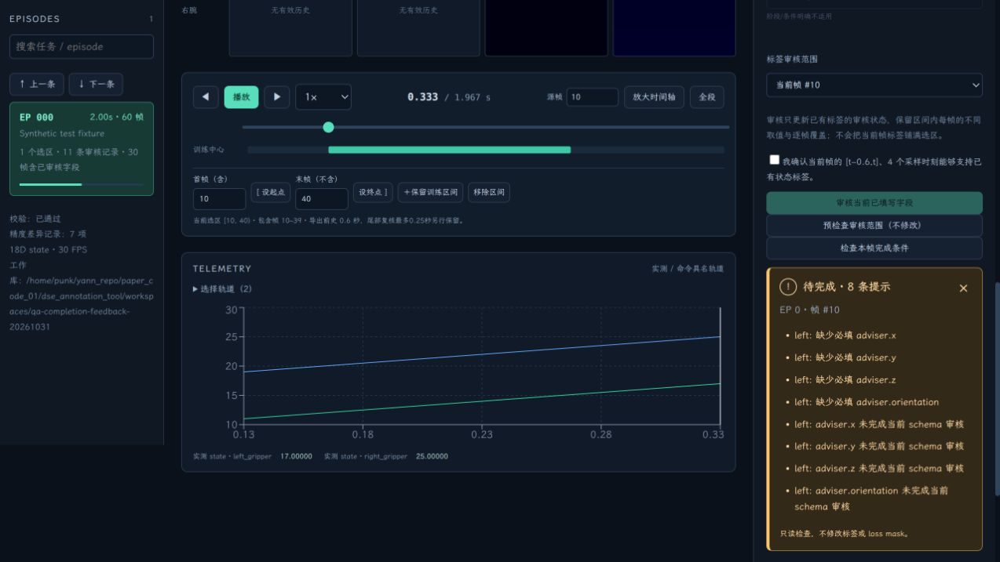
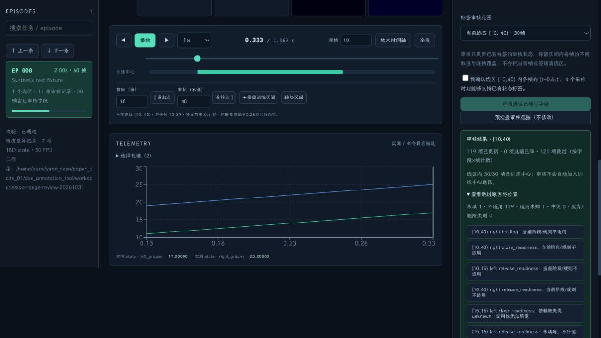

# 标签审核与整段审核

## 两个按钮分别做什么

**审核当前已填写字段**：更新已有标签的 review_status 为 reviewed，确认这份值可作为监督。loss mask 由「训练中心 + 已填写 + 当前字段适用 + 已审核 + 当前 schema 有效」共同计算，不是直接把整帧或所有字段强制设为 mask=1。允许先审核 phase 等部分字段，不要求一次填满所有头。

**检查本帧完成条件**：只读检查本帧所有必填字段、审核缺口和内置语义冲突，不修改值、审核状态或 mask。它检查完整性，并不替代人工审核。状态字段已审、adviser 仍缺失时，完成检查可以不通过，但已有有效状态监督仍保留。

检查结果现在直接显示在按钮下方：绿色“检查通过”、黄色“待完成”并逐条列出提示，服务错误也在原处显示。结果自动进入可见区域并获得键盘焦点，不用回到页面顶部。换帧、切换数据或修改标签后旧结果失效；未确认的赋值草稿不参与本次已保存标签检查，卡片会说明。

## 现在可以直接审核整段

1. 设置首帧（含）、末帧（不含），或点击时间轴上已有训练中心区间。
2. 在 ANNOTATION 中，将「标签审核范围」从「当前帧」切换为「当前选区」。审核范围与“给选区统一赋值”的开关相互独立。
3. 如有未提交的整组赋值草稿，先确认保存。审核只读取已保存值。
4. 可选点击「预检查审核范围（不修改）」，查看可更新、此前已审和跳过的项数。
5. 状态模式勾选确认：所选范围各帧的允许历史证据支持这些标签。点击「审核选区已填写字段」一次提交。

无需逐帧点击审核，也不需要把当前帧标签复制到整段。区间里原有的阶段变化、类别差异、单帧覆盖、label_source 和原始来源 metadata 都保留。缺失不补值；明确不适用、适用性未知、废弃/删除类别和语义冲突会跳过。冲突按手臂跳过，另一臂的有效字段仍可审核。结果按字段×帧计数，展开可看位置，点击问题记录可跳到对应帧。

状态模式只审状态字段；行为模式同样可以整段审 adviser 等行为字段。adviser 标签审核不等于把示教动作区间设为 approved，也不自动生成 adviser 真值。

## 撤销、版本与训练中心

一次整段提交对应一次撤销/重做。失败全部回滚；不会因某一步写入失败留下半段审核结果。已经在同一 schema、同一历史配置下审核的项跳过重复写入；改变历史设置后，新的人工确认会更新审核证据配置。

审核不会改变训练中心选区。范围外的标签不变；未被选为训练中心的帧即使审核了标签，导出时仍然 mask=0。结果卡会显示审核范围内有多少帧属于训练中心。服务会检查 schema 与标注修订号，避免审核界面加载之后已被改动的标签。

当前「检查本帧完成条件」仍明确只检查当前游标帧，不会因为标签审核范围切到选区就自动改变其含义。

## 验证

- 38项回归测试通过。包括逐帧差异、点覆盖优先、范围裁剪、missing/unknown/不适用/冲突、独立 holding、模式隔离、历史配置、重复审核、一次撤销/重做、写入失败回滚、schema/修订号保护、导出 loss mask 与独立导出源帧坐标。
- 10,000帧范围的测试中，审核其中9,800帧的同一连续标签仅新增1条已审区间，保留两侧草稿；不生成9,800条逐帧覆盖。
- 浏览器在明确的合成夹具上一次审核 [10,40)：119字段×帧更新；单帧15保持 phase=8，后半段保持 phase=4。一次撤销恢复整段草稿。未对真实数据伪造人工审核。
- 前端 TypeScript/Vite 构建、Python/前端格式检查通过。结果见 [验收记录](range-review-validation.json)。

