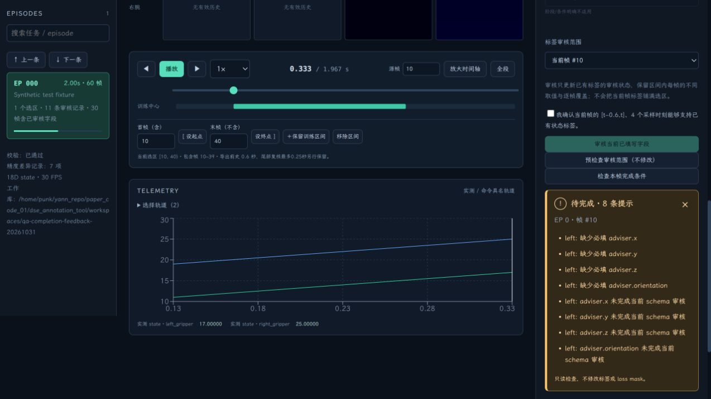
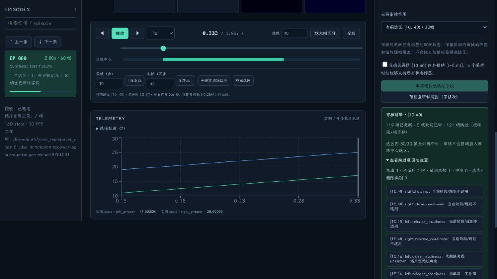

# Label Review and Range Review

English | [简体中文](RANGE_REVIEW_2026-10-31.md)

## What the Two Buttons Do

**审核当前已填写字段** (Review currently filled fields) changes existing labels' review_status to reviewed, confirming that their values may serve as supervision. Loss masks jointly require a training center, a filled value, current applicability, completed review, and the current schema version; the button does not force mask=1 for an entire frame or all fields. Partial review, such as reviewing phase first, is supported without filling every head at once.

**检查本帧完成条件** (Check completion conditions for this frame) checks required fields, review gaps, and built-in semantic conflicts without changing values, review status, or masks. It checks completeness and does not replace human review. If state fields are reviewed but adviser remains missing, completion may fail while valid state supervision remains.

Results now appear directly below the button: green **检查通过** (Check passed), yellow **待完成** (Incomplete) with individual issues, or an error in the same place. The result scrolls into view and receives keyboard focus without requiring a return to the top. Changing frame/dataset or editing labels invalidates old results. Pending assignment drafts are excluded from the saved-label check, as explained on the result card.

## Review an Entire Range

1. Set an inclusive start and exclusive end, or click an existing training-center range on the timeline.
2. In ANNOTATION, change **标签审核范围** (Label-review scope) from **当前帧** (Current frame) to **当前选区** (Current selection). Review scope is independent of the switch for assigning a uniform value to a selection.
3. Confirm and save any pending group-assignment drafts first. Review reads saved values only.
4. Optionally click **预检查审核范围（不修改）** (Precheck review range, no changes) to count entries that can be updated, were already reviewed, or will be skipped.
5. In state mode, confirm that each frame's permitted historical evidence supports its labels. Click **审核选区已填写字段** (Review filled fields in selection) once.

There is no need to review frame by frame or copy the current labels over the whole selection. Existing phase transitions, category differences, single-frame overrides, label_source, and original provenance metadata remain. Missing values are not filled; explicitly inapplicable, undetermined, deprecated/deleted, and conflicting entries are skipped. Conflicts skip the affected arm; valid fields on the other arm can still be reviewed. Counts use field×frame pairs. Expand results for locations and click an issue to jump to its frame.

State mode reviews state fields only. Behavior mode also supports range review for adviser and other behavior fields. Reviewing adviser labels does not approve demonstration action ranges or automatically create adviser ground truth.

## Undo, Versions, and Training Centers

One range submission corresponds to one undo/redo. Failure rolls back the whole operation rather than leaving a partially reviewed range. Entries already reviewed under the same schema and history configuration are not rewritten. After history settings change, a new human confirmation updates the recorded evidence configuration.

Review does not change training-center selections. Labels outside the review range remain unchanged. Reviewed frames that are not selected centers still export with mask=0. The result card reports how many reviewed-range frames are training centers. The service checks schema and annotation revision numbers to avoid reviewing labels changed since the UI loaded them.

**检查本帧完成条件** still checks only the current cursor frame. Switching review scope to a range does not change that button's meaning.

## Validation

- 38 regression tests passed at the time of this report, covering per-frame differences, point-override priority, range clipping, missing/unknown/inapplicable/conflicting values, independent holding, mode isolation, history settings, repeat review, single undo/redo, write-failure rollback, schema/revision protection, exported loss masks, and source coordinates in standalone exports.
- In a 10,000-frame test, reviewing 9,800 frames of one continuous label added only one reviewed interval and preserved drafts on both sides rather than creating 9,800 point overrides.
- Browser review on an explicit synthetic fixture updated 119 field×frame pairs over [10,40). Frame 15 retained phase=8; the second half retained phase=4. One undo restored drafts across the range. No human reviews were fabricated on real data.
- Frontend TypeScript/Vite build and Python/frontend formatting checks passed. See the [acceptance record](range-review-validation.json).

